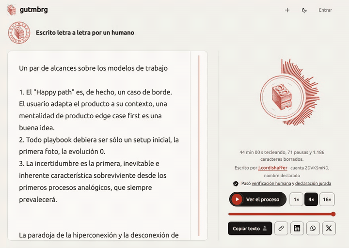

**[English]** · [(En español más abajo)](#español)

# Flow — Software Development Life Network

[](https://github.com/awarefractal/flow-sdln/actions/workflows/ci.yml)
[](LICENSE)
[](CHANGELOG.md)
[](scripts/check.mjs)
[](https://app.gutmbrg.com/p/djruNccm)


Flow (SDLN, Software Development Life Network) is a human + AI work framework. It turns an idea into a product with traceability: a network of cycles (capture, define, explore, decide, deliver, learn) that run when they have their inputs, a living PRD, a backlog read through indexes, versioned state that several sessions and people can share without stepping on each other, and a close that leaves everything up to date. It does not depend on the project or on the AI you use.

[](https://awarefractal.github.io/flow-sdln/)

**Read the playbook online:** [awarefractal.github.io/flow-sdln](https://awarefractal.github.io/flow-sdln/) (formatted, in Spanish) · or as Markdown: [PLAYBOOK.md](PLAYBOOK.md)

[](https://app.gutmbrg.com/p/djruNccm)

*Why Flow exists (section 0 of the playbook), typed by hand and verified on [gutmbrg](https://app.gutmbrg.com/p/djruNccm).*

> Status: v0.2.0, pre-release. The setup has only been dry-run, never with an AI on a real project (see [CHANGELOG.md](CHANGELOG.md)). The kit is written in Spanish.

## Why it exists

The happy path is an edge case, a playbook should only be the first snapshot, and uncertainty never goes away. Flow is a small starting setup for working that way: decide early, declare what is unknown, let the product change course, and keep the memory outside any single conversation. The full story is in [PLAYBOOK.md](PLAYBOOK.md), section 0 (in Spanish).

## How to use it

In your project, with your AI open: "read `setup/SETUP.md` from the Flow kit and run it". The setup asks one open question, infers the rest, and generates `.flow/` plus the guide file and skill for your AI.

## Not affiliated

Flow works with Claude Code, Codex and OpenCode through adapters. It is an independent project and is not affiliated with, endorsed by or sponsored by Anthropic, OpenAI or the OpenCode project. Names belong to their owners.

## License

[MIT](LICENSE) (a courtesy translation is in [LICENSE.es.md](LICENSE.es.md)). See also [SECURITY.md](SECURITY.md) and [CONTRIBUTING.md](CONTRIBUTING.md).

---

# Español

# Flow — Software Development Life Network


Flow (SDLN, Software Development Life Network) es un framework de trabajo humano + IA. Convierte una idea en un producto con trazabilidad: una red de ciclos (captar, definir, explorar, decidir, entregar, aprender) que se activan según su combustible, un PRD vivo, un backlog que se lee por índices, estado versionado que varias sesiones y personas pueden compartir sin pisarse, y un cierre que deja todo al día. No depende del proyecto ni de la IA que se use.

[](https://awarefractal.github.io/flow-sdln/)

**Lee el playbook en línea:** [awarefractal.github.io/flow-sdln](https://awarefractal.github.io/flow-sdln/) (con formato) · o en Markdown: [PLAYBOOK.md](PLAYBOOK.md)

[](https://app.gutmbrg.com/p/djruNccm)

*Por qué existe Flow (sección 0 del playbook), escrita a mano y verificada en [gutmbrg](https://app.gutmbrg.com/p/djruNccm).*

> Estado: v0.2.0, pre-lanzamiento. El setup solo se probó en seco, nunca con una IA en un proyecto real (ver `CHANGELOG.md`). Cómo funciona, explicado para humanos: `PLAYBOOK.md`.

## Por qué existe

El camino feliz es un caso de borde, un playbook debiera ser solo la primera foto, y la incertidumbre nunca desaparece. Flow es un setup inicial pequeño para trabajar así: decidir temprano, declarar lo que no se sabe, dejar que el producto cambie de rumbo y mantener la memoria fuera de cualquier conversación. La historia completa está en [PLAYBOOK.md](PLAYBOOK.md), sección 0.

## Cómo se usa

En el proyecto, con tu IA abierta: «lee `setup/SETUP.md` del kit Flow y ejecútalo». El setup te hace una pregunta abierta, infiere el resto y genera `.flow/` más el archivo guía y el skill de tu IA.

## Mapa del kit

```
flow/
├─ README.md · PLAYBOOK.md · docs/ (playbook en HTML, GIF, social preview) · VERSION · CHANGELOG.md · LICENSE · LICENSE.es.md
├─ SECURITY.md · CONTRIBUTING.md · CODE_OF_CONDUCT.md · CLAUDE.md
├─ scripts/check.mjs               chequeo de enlaces y datos locales (lo corre el CI)
├─ setup/
│  ├─ SETUP.md                     protocolo de entrevista, sin cuestionario
│  └─ verificar.md                 chequeos de coherencia
├─ nucleo/
│  ├─ contexto/
│  │  ├─ CONTEXT.plantilla.md      el contrato del proyecto
│  │  ├─ guia.base.md              fuente única del archivo guía de cualquier IA
│  │  └─ ponytail.md               la escalera de mínimo esfuerzo
│  ├─ motor/
│  │  ├─ SKILL.base.md             el ciclo; es el índice del mecanismo
│  │  └─ referencia/               red · bootstrap · coordinacion · revision · backlog-externo · dimensionado · checkpoints · cierre · excepciones · metricas
│  ├─ hooks/                       catálogo de hooks · flow-hooks.mjs · _agregar-un-hook.md
│  ├─ plantillas/                  formato de lo que la IA crea al trabajar
│  ├─ esqueleto/                   lo que el setup copia a .flow/
│  └─ catalogo/                    áreas de decisión por tipo de proyecto
├─ adaptadores/                    claude-code · codex · opencode · _agregar-una-ia.md
└─ modulos/                        diseno · qa-navegador · _agregar-un-modulo.md
```

## Qué genera en un proyecto

```
<proyecto>/
├─ CLAUDE.md | AGENTS.md           generado desde nucleo/contexto/guia.base.md
├─ <ruta de skills>/flow/          SKILL.md + referencia/ + plantillas/ + catalogo/
└─ .flow/                          config · INDEX · CONTEXT · PRD · bandeja · errores · capacidades
   ├─ dominio/                     INDICE · vigencia-docs · decisiones/ · (referencias/)
   ├─ bitacora/                    INDICE · entradas/
   ├─ motor/                       backlog/ (INDICE · puntos/) · planes/ (activos · hechos)
   └─ modulos/<m>/                 solo los activos
```

## Convenciones

- `{{variable}}` lo rellena el setup; la tabla de variables está en `setup/SETUP.md`.
- `*.plantilla.md` y `*.base.md` se copian al proyecto con las variables resueltas. Los archivos de `plantillas/` sin ese sufijo son el formato de documentos que la IA crea mientras trabaja.
- `.flow/` va versionado en git: es lo que permite compartir estado, bloqueos y rastro.
- Una sola fuente: el proyecto recibe copias generadas; lo generado no se edita a mano, se vuelve a correr el setup.
- Minimalismo como regla general: ningún archivo, campo o paso que nadie haya pedido.
- Se navega por índices: `INDEX.md` → `INDICE.md` de la carpeta → solo el archivo necesario.
- Lo que depende de herramientas de terceros (adaptadores) declara qué está verificado y qué no, con fuente y fecha.

## Sin afiliación

Flow funciona con Claude Code, Codex y OpenCode a través de adaptadores. Es un proyecto independiente, sin afiliación, aval ni patrocinio de Anthropic, OpenAI ni del proyecto OpenCode. Los nombres son de sus dueños.

## Licencia

[MIT](LICENSE) (traducción de cortesía en [LICENSE.es.md](LICENSE.es.md)). Ver también [SECURITY.md](SECURITY.md) y [CONTRIBUTING.md](CONTRIBUTING.md).
